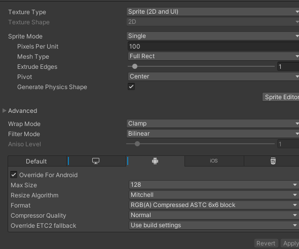
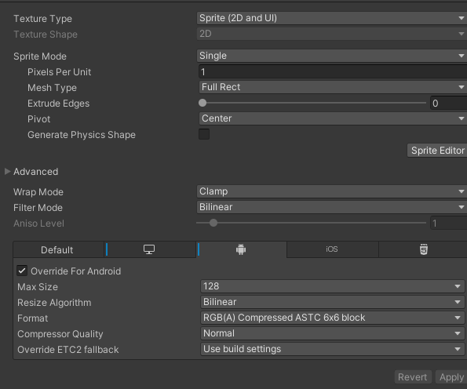

# BEFORE

## Texture setting

## Particle System

- Max particles is set at 1000 is too high for a short effect
- Start Size, Delay, Lifetime, Speed are using random between constants but both is min max is the same
- When played all, highest batched drawcall was at 27 with total drawcall at 29
- ParticleSystem.Update was at 0.036ms

---

# AFTER

## Texture setting

## Particle System

- Max particles should follow emission rate × duration with an addition for overhead
- Start Size, Delay, Lifetime, Speed should be using constant if min = max
- When played all, highest batched drawcall was at 23-25 with total drawcall at 28
- ParticleSystem.Update was at 0.026ms
